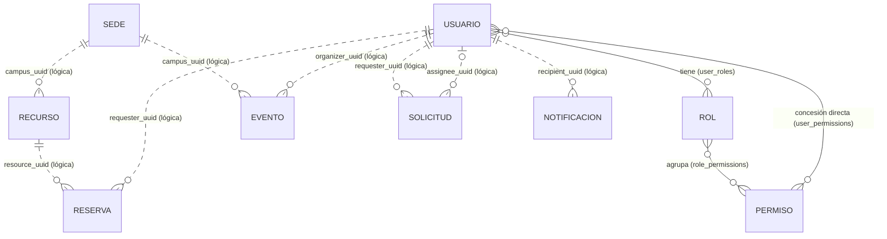
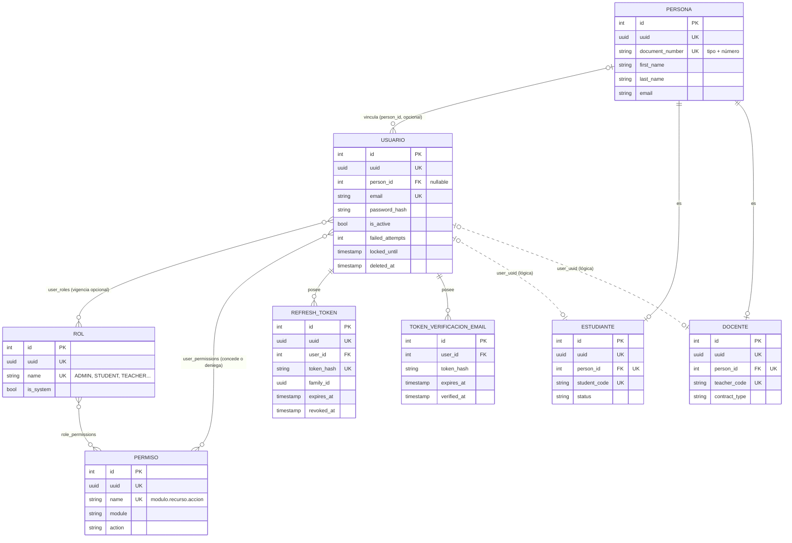
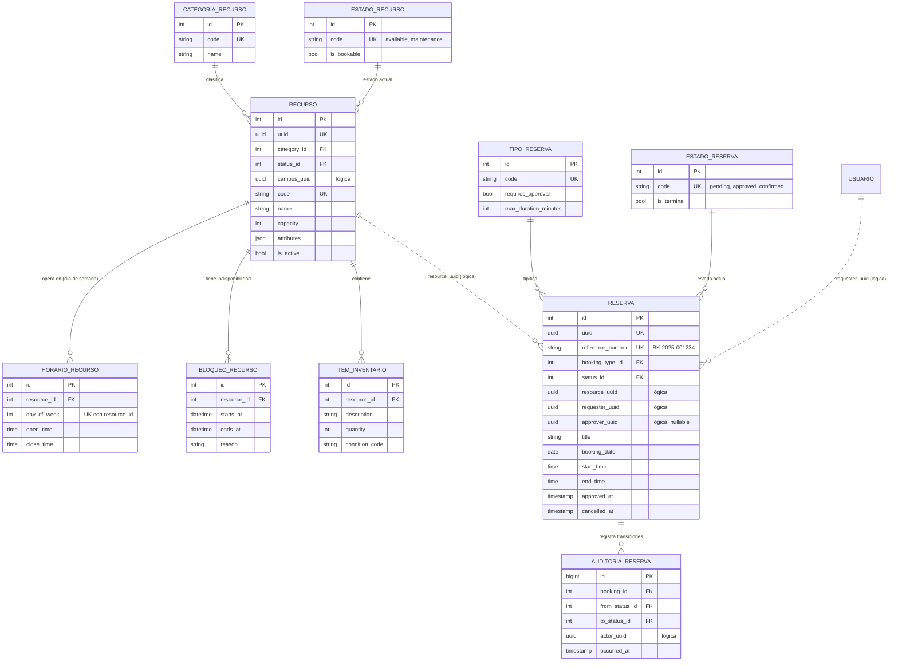
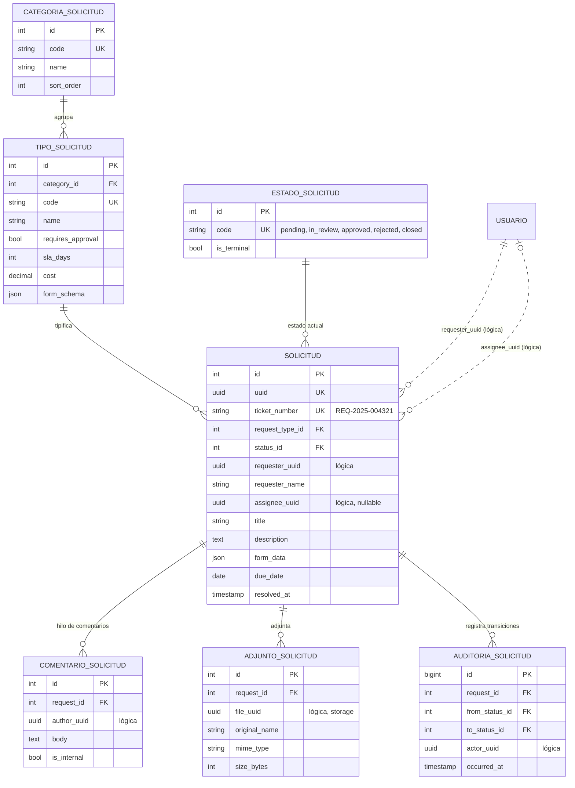
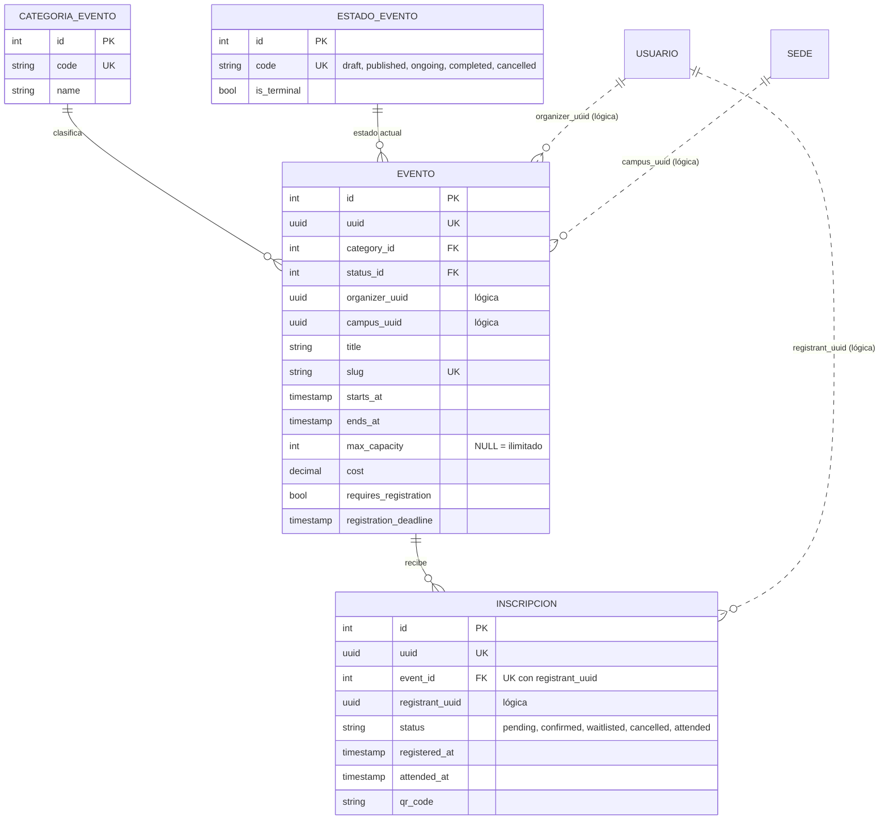
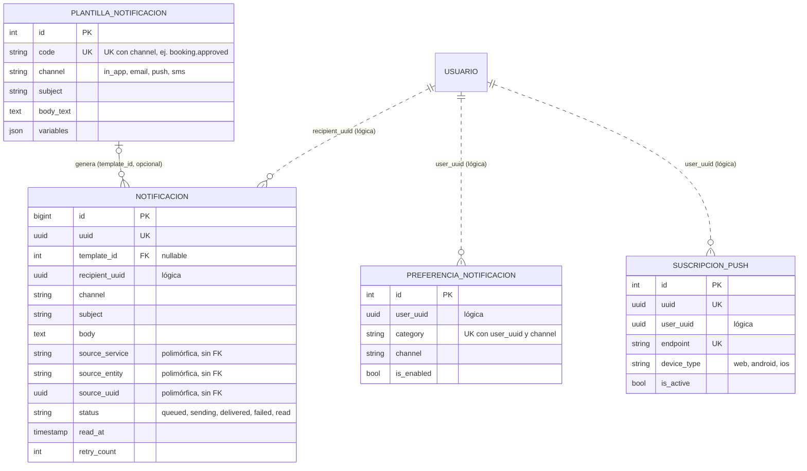

# Diagrama Entidad-Relación (ER) de UAJS Smart Campus

El modelo sale de las migraciones SQL en `scripts/migrations/` (`ms-*_001_init.sql`). Cada microservicio tiene su propia base de datos y no hay claves foráneas entre bases. Por eso hay dos tipos de relación:

- **Línea continua (`──`)**: clave foránea real dentro de la misma base de datos.
- **Línea punteada (`..`)**: referencia lógica entre servicios. Se guarda como `uuid` (`CHAR(36)`) más una columna desnormalizada con el nombre.

Notación de cardinalidad (crow's foot): `||` uno y solo uno, `|o` cero o uno, `o{` cero o muchos, `}o` uno o muchos.

## 1. Mapa general de dominios

## 2. Identidad y RBAC (`uajs_auth` + `uajs_academic`)

## 3. Recursos y reservas (`uajs_resources` + `uajs_bookings`)

## 4. Solicitudes (`uajs_requests`)

## 5. Eventos (`uajs_events`)

## 6. Notificaciones (`uajs_notifications`)

## Puntos a tener en cuenta del modelo

1. **Cardinalidad de `USUARIO` a `PERSONA`**: `users.person_id` es nullable y no tiene restricción de unicidad, así que técnicamente una persona puede tener varios usuarios. En cambio, `estudiantes` y `docentes` sí tienen `person_id` único, por lo que la relación con `PERSONA` es 1:0..1.
2. **`PERSONA` aparece en dos bases**: la maestra está en `uajs_academic` y la instantánea mínima en `uajs_auth`. Solo la de `auth` se relaciona con `USUARIO`.
3. **Control de solapes en reservas**: `uq_bookings_slot (resource_uuid, booking_date, start_time)` solo impide reservas que empiezan a la misma hora. No detecta solapes parciales (por ejemplo, 9:00–11:00 y 10:00–12:00). Esa validación tiene que hacerse en la aplicación.
4. **Horarios por recurso**: `uq_resource_schedules_slot (resource_id, day_of_week)` permite una sola ventana operativa por día y recurso.
5. **Notificaciones polimórficas**: `source_service`, `source_entity` y `source_uuid` apuntan a cualquier entidad de cualquier servicio, sin FK. En el diagrama se marcan como "polimórfica".
6. **Fuera del diagrama**: PQRS (`uajs_pqrs`), almacenamiento (`uajs_storage`), empresas, catálogos geográficos y tokens de recuperación de contraseña.
