# 3. Diagramas definitivos

> Diagrama de arquitectura y modelo de datos según la implementación real del
> monorepo (verificado contra el código: `apps/api-gateway/src/middleware/proxy.middleware.js`,
> `apps/*/src/config/env.js`, `scripts/migrations/*.sql`, `scripts/seed/*.sql`,
> `apps/*/src/jobs/{producers,consumers}/*.js` y `packages/shared-elasticsearch/src/client.js`).

---

## 3.1. Diagrama de arquitectura general

Vista por bloques: 1 gateway de entrada, 11 servicios detrás, y la infraestructura
compartida (MySQL en el mismo servidor instancia con 10 bases, Redis para BullMQ
y Elasticsearch para búsqueda + auditoría).

```mermaid
graph TB
    subgraph CLIENTE["Cliente / Frontend"]
        FE["Navegador / App móvil"]
    end

    subgraph EDGE["Capa de entrada"]
        GW["api-gateway :3000<br/>helmet · CORS · express.json(10mb) · request-id<br/>billing: rate-limit por IP → JWT → rate-limit por usuario<br/>proxy http-proxy-middleware + pathRewrite"]
    end

    subgraph MS["Microservicios (Express · controller→service→repository · Zod)"]
        AUTH["auth-service :3001<br/>uajs_auth · login/refresh/reset · JWT roles[]"]
        USER["user-service :3002<br/>uajs_auth (comparte BD) · perfil/rol/permiso/usuario"]
        CAT["catalog-service :3003<br/>uajs_catalog · campus/ciudad/depto/tipo-doc"]
        UNI["university-service :3004<br/>uajs_academic · sede/facultad/programa/<br/>estudiante/docente/empresa"]
        RES["resource-service :3005<br/>uajs_resources · recurso/categoría/horario/bloqueo"]
        BOK["booking-service :3006<br/>uajs_bookings · reserva + audit trail"]
        REQ["request-service :3007<br/>uajs_requests · solicitud/comentario/adjunto"]
        EVT["event-service :3008<br/>uajs_events · evento/inscripción (lista de espera)"]
        NOT["notification-service :3009<br/>uajs_notifications · notif/plantilla/preferencia/push"]
        PQRS["pqrs-service :3010<br/>uajs_pqrs · radicación anónima + respuesta"]
        STO["storage-service :3011<br/>uajs_storage · metadata de archivos (binario en disco)"]
    end

    subgraph INFRA["Infraestructura (docker-compose: MySQL 3307 · Redis 6379 · ES 9200)"]
        MYSQL[("MySQL 8<br/>10 bases de datos<br/>uajs_*")]
        REDIS[("Redis 7<br/>BullMQ")]
        ES[("Elasticsearch 8.12<br/>13 índices uajs_*")]
    end

    FE --"HTTPS /api/v1/{español}"--> GW

    GW -->|"/api/v1/auth"| AUTH
    GW -->|"/api/v1/usuarios"| USER
    GW -->|"/api/v1/catalogos"| CAT
    GW -->|"/api/v1/universidad"| UNI
    GW -->|"/api/v1/recursos"| RES
    GW -->|"/api/v1/reservas"| BOK
    GW -->|"/api/v1/solicitudes"| REQ
    GW -->|"/api/v1/eventos"| EVT
    GW -->|"/api/v1/notificaciones"| NOT
    GW -->|"/api/v1/pqrs"| PQRS
    GW -->|"/api/v1/archivos"| STO

    AUTH & USER --> MYSQL
    CAT & UNI & RES & STO --> MYSQL
    BOK & REQ & EVT & PQRS & NOT --> MYSQL

    AUTH --"BullMQ: auth_emails"--> REDIS
    NOT --"BullMQ: notification_events"--> REDIS
    BOK & REQ & EVT & PQRS --"BullMQ: *_events + notification_events"--> REDIS
    CAT & UNI & RES & STO & AUTH & USER --"BullMQ: *_events (auditoría)"--> REDIS
    REDIS --> NOT

    GW & AUTH --"logs de acceso/auditoría"--> ES
    CAT & UNI & RES & STO & AUTH & USER --"índice *_events"--> ES
    BOK & REQ & EVT & PQRS & NOT --"índice *_events"--> ES
    AUTH -.->|"index de dominio"| ES

    BOK -.->|"HTTP GET disponibilidad · X-Service-Token"| RES
    REQ -.->|"HTTP GET archivo meta"| STO
    PQRS -.->|"HTTP GET archivo meta"| STO
    USER -.->|"HTTP GET perfil académico (opcional)"| UNI
```

**Leyenda**: línea continua = llamada directa o consulta; discontinua `-.->` =
llamada HTTP entre servicios o escritura en ES; los servicios comparten Redis y
Elasticsearch como infraestructura transversal.

> Nota real: ningún servicio es scaffold vacío — los 12 tienen código completo
> (el patrón de módulos del AGENTS.md está desactualizado); catalog-service
> implementa 4 módulos (campus, city, department, document-type).

---

## 3.2. Ruteo del API Gateway

Los prefijos **públicos están en español**; cada servicio monta sus rutas
**internas en inglés**. El `pathRewrite` explícito de `SERVICE_MAP` traduce el
prefijo al reenviar (`http-proxy-middleware` no lo hace solo):

| Prefijo público (gateway) | Servicio (puerto) | Ruta interna (pathRewrite) | Acceso |
| --- | --- | --- | --- |
| `/api/v1/auth` | auth-service (3001) | `/api/v1/auth` | login/register/reset **públicos**; resto JWT |
| `/api/v1/usuarios` | user-service (3002) | `/api/v1/users` | JWT |
| `/api/v1/catalogos` | catalog-service (3003) | `/api/v1/catalog` | JWT |
| `/api/v1/universidad` | university-service (3004) | `/api/v1/university` | JWT |
| `/api/v1/recursos` | resource-service (3005) | `/api/v1/resources` | JWT |
| `/api/v1/reservas` | booking-service (3006) | `/api/v1/bookings` | JWT |
| `/api/v1/solicitudes` | request-service (3007) | `/api/v1/requests` | JWT |
| `/api/v1/eventos` | event-service (3008) | `/api/v1/events` | JWT |
| `/api/v1/notificaciones` | notification-service (3009) | `/api/v1/notifications` | JWT |
| `/api/v1/pqrs` | pqrs-service (3010) | `/api/v1/pqrs` | JWT |
| `/api/v1/archivos` | storage-service (3011) | `/api/v1/storage` | JWT |

```mermaid
flowchart LR
    R["Petición externa<br/>/api/v1/reservas/123"] --> G["api-gateway"]

    subgraph MW["Cadena de middlewares (en orden)"]
        M1[helmet/CORS/json] --> M2[request-id + ES logging] --> M3[health]
        M3 --> M4[rate-limit por IP] --> M5[auth JWT<br/>exige sub · uuid · roles[]] --> M6[rate-limit por usuario]
        M6 --> M7["SERVICE_MAP + pathRewrite<br/>^/api/v1/reservas → /api/v1/bookings"]
    end

    G --> MW --> P["proxy http-proxy-middleware"]
    P --"headers: X-Request-Id · X-Service-Token<br/>X-User-Id/X-User-Uuid/X-User-Name/X-User-Roles ( sanctitizados)<br/>fixRequestBody al final"--> S["booking-service :3006<br/>/api/v1/bookings/123"]
    S --> RESP["Respuesta 2xx/40x/503"]
```

Errores de proxy: `ECONNREFUSED/ENOTFOUND → 503`, timeout → `504`, resto `502`
(gateway con `timeout/proxyTimeout` de 30 s).

---

## 3.3. Modelo de datos definitivo

Principios verificados en las migraciones:

- **Una base por servicio** en el mismo servidor MySQL (10 bases). `user-service`
  comparte `uajs_auth`. El gateway no tiene base de datos.
- **FK solo intra-base** (`RESTRICT`/`CASCADE`/`SET NULL`). Las referencias
  entre bases se modelan como `*_uuid CHAR(36)` + columna de instantánea
  desnormalizada `*_name` (nunca FK), para respetar la propiedad de datos de
  cada microservicio.
- **Tablas de estado/catálogo** por dominio (`*_statuses`, `*_types`,
  `*_categories`) sembradas idempotentemente; el flujo `create()` de
  bookings/requests/events/pqrs busca el estado inicial por código
  (`pending`/`draft`) y falla con `404` si la seed no corrió.

### 3.3.1. Dominio de identidad — `uajs_auth` (auth-service + user-service)

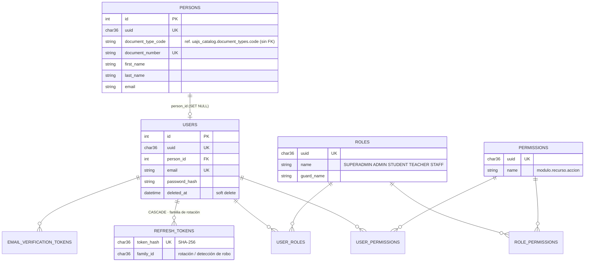

### 3.3.2. Catálogo maestro — `uajs_catalog` (catalog-service)

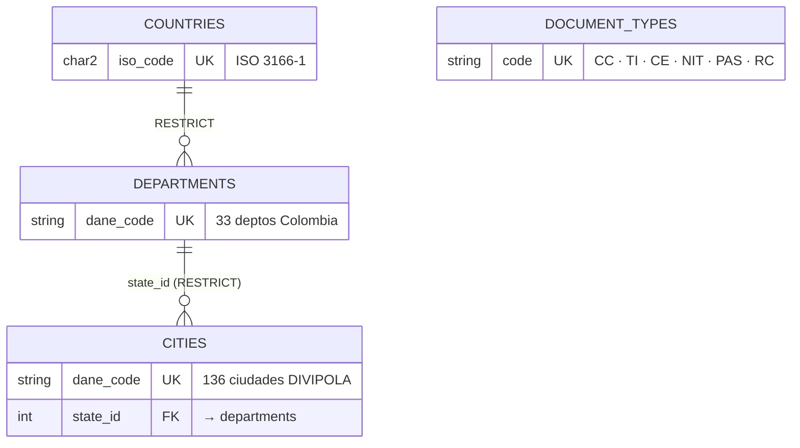

### 3.3.3. Dominio académico — `uajs_academic` (university-service)

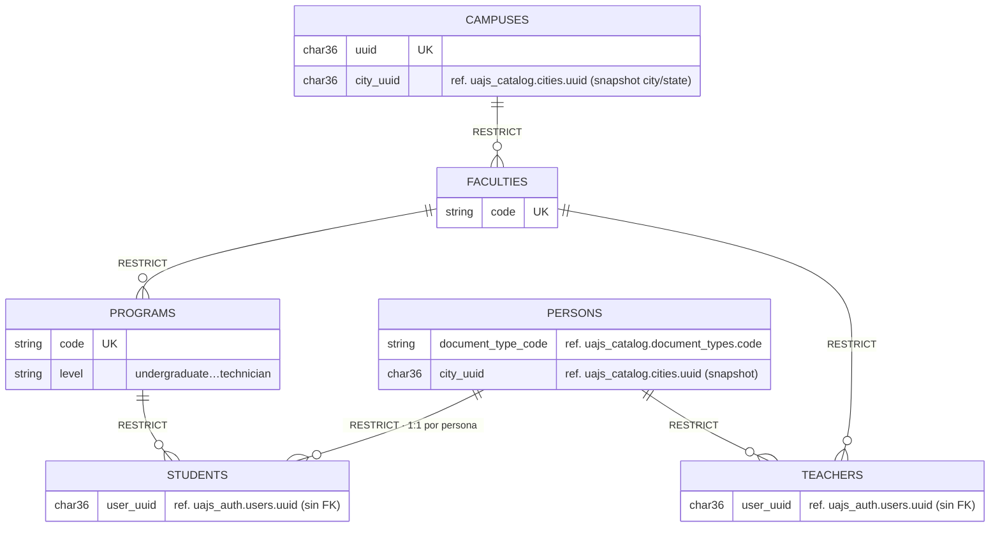

> Seed cruzada real: `ms-academic_001_seed.sql` resuelve
> `campuses.city_uuid` con subconsulta `SELECT uuid FROM uajs_catalog.cities
> WHERE dane_code = '11001'` — debe ejecutarse **después** de la seed de
> catálogo.

### 3.3.4. Dominio de recursos y reservas — `uajs_resources` + `uajs_bookings`

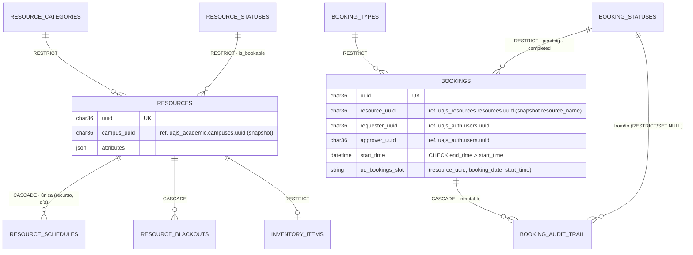

Anti-solapamiento real: única `uq_bookings_slot(resource_uuid, booking_date,
start_time)` + el servicio consulta disponibilidad vía resource-service
(`GET /api/v1/resources/recursos/:id/disponibilidad`).

### 3.3.5. Dominio de solicitudes — `uajs_requests` (request-service)

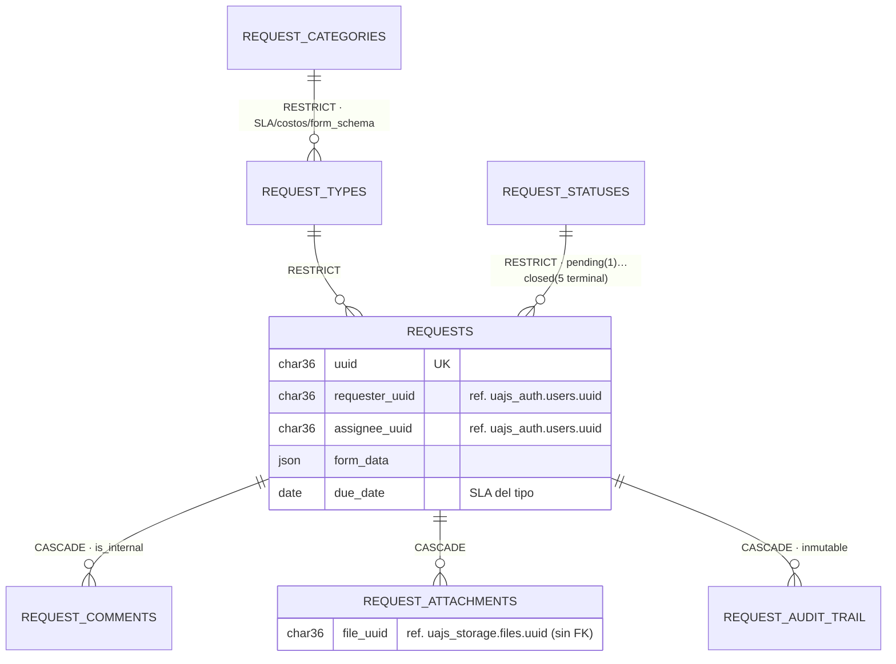

### 3.3.6. Dominio de eventos — `uajs_events` (event-service)

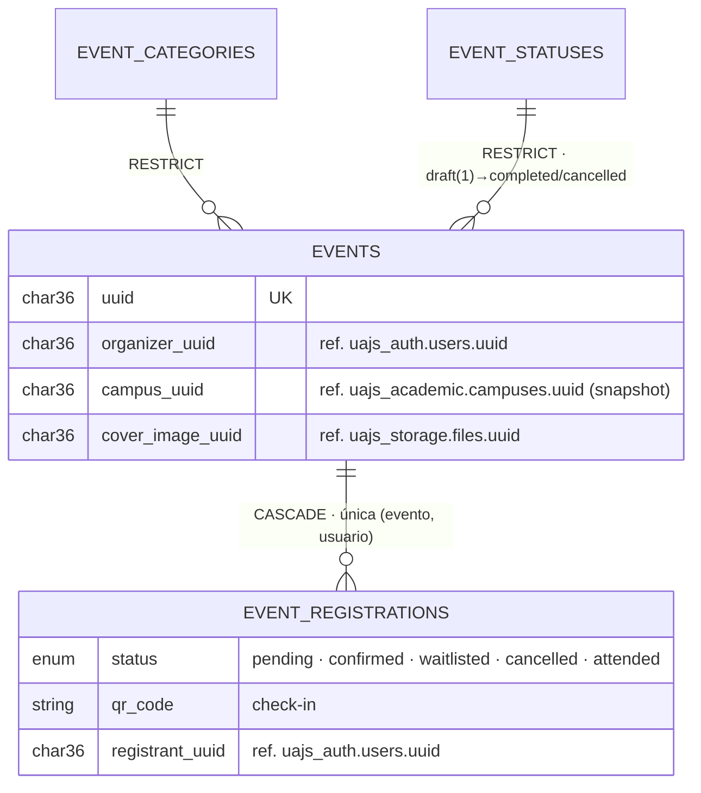

Lista de espera real: `status = 'waitlisted'` y la promoción de cupo dispara el
evento `inscripcion_promovida` hacia notification-service.

### 3.3.7. Dominio PQRS — `uajs_pqrs` (pqrs-service, radicación anónima)

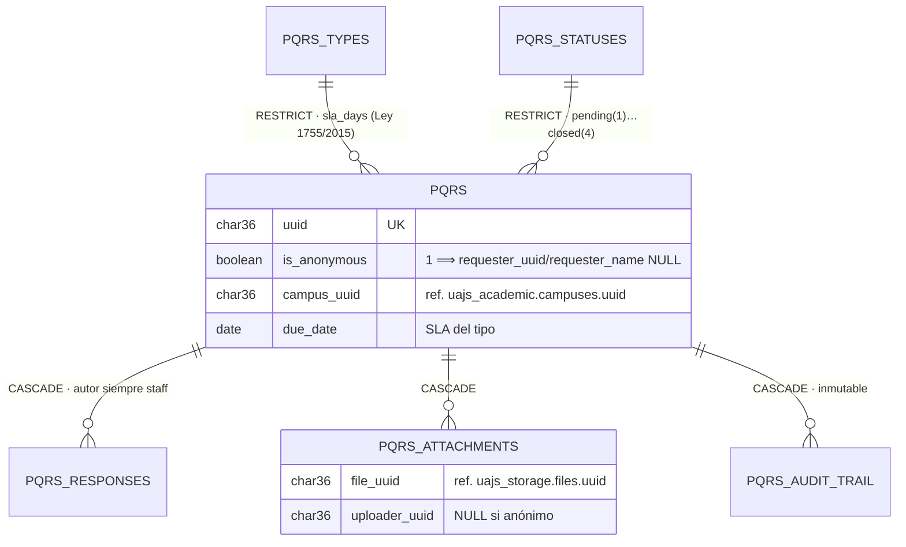

### 3.3.8. Dominios transversales — `uajs_notifications` + `uajs_storage`

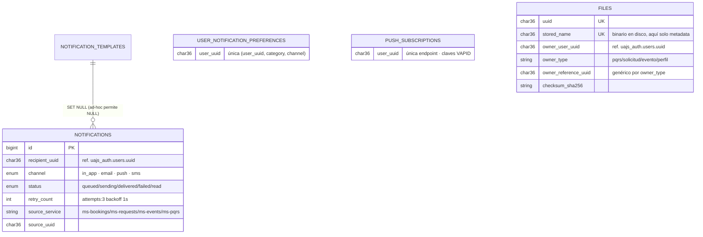

> Real: **no existen seeds** para `uajs_notifications` ni `uajs_storage`
> (solo `_init`); no lo requieren porque sus flujos no dependen de filas
> sembradas.

### 3.3.9. Mapa de referencias cruzadas entre bases (por `*_uuid`, sin FK)

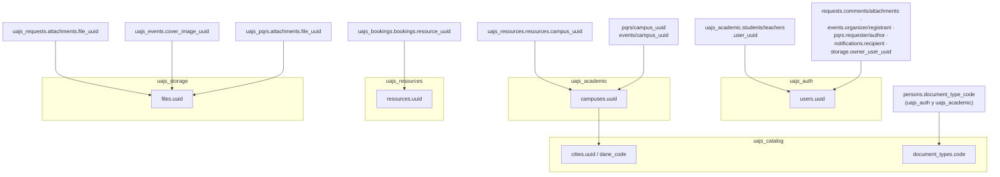

**Desglose completo** (origen.columna → destino):

| Origen (base.columna) | Destino | Instantánea |
| --- | --- | --- |
| `uajs_auth.persons.document_type_code` | `uajs_catalog.document_types.code` | — |
| `uajs_academic.{campuses,companies,persons}.city_uuid` | `uajs_catalog.cities.uuid` | `city_name`, `state_name` |
| `uajs_academic.persons.document_type_code` | `uajs_catalog.document_types.code` | — |
| `uajs_academic.{students,teachers}.user_uuid` | `uajs_auth.users.uuid` | índice |
| `uajs_resources.resources.campus_uuid` | `uajs_academic.campuses.uuid` | `campus_name` |
| `uajs_resources.resource_blackouts.created_by_uuid` | `uajs_auth.users.uuid` | — |
| `uajs_bookings.bookings.resource_uuid` | `uajs_resources.resources.uuid` | `resource_name` |
| `uajs_bookings.bookings.{requester,approver}_uuid` | `uajs_auth.users.uuid` | — |
| `uajs_requests.{requests,comments,attachments}.{requester,assignee,author,uploader}_uuid` | `uajs_auth.users.uuid` | — |
| `uajs_requests.attachments.file_uuid` | `uajs_storage.files.uuid` | `file_name` |
| `uajs_events.events.{organizer,campus,cover_image}_uuid` | `uajs_auth` / `uajs_academic` / `uajs_storage` | snapshots |
| `uajs_events.event_registrations.registrant_uuid` | `uajs_auth.users.uuid` | — |
| `uajs_pqrs.{pqrs,responses,attachments}.…_uuid` | `uajs_auth` / `uajs_academic` / `uajs_storage` | — |
| `uajs_notifications.{notifications,preferences,push_subscriptions}.user_uuid` | `uajs_auth.users.uuid` | — |
| `uajs_storage.files.{owner_user,owner_reference}_uuid` | `uajs_auth.users.uuid` / entidad propietaria | — |

---

## 3.4. Diagrama de colas y eventos de dominio (BullMQ sobre Redis)

Cada servicio de negocio publica en **una cola propia de auditoría** (`*_events`,
cuyo único consumidor es su índice ES `*_events`) y los 4 servicios que generan
notificaciones adicionales publican en la **cola compartida**
`notification_events` — es la misma cola que escucha notification-service.

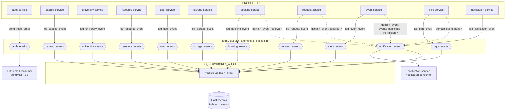

### 3.4.1. `EVENT_DEFINITIONS` (notification-service)

El `domain-events.consumer.js` registra la notificación in-app por cada evento;
los desconocidos o sin `recipientUuid` se descartan (`skip`):

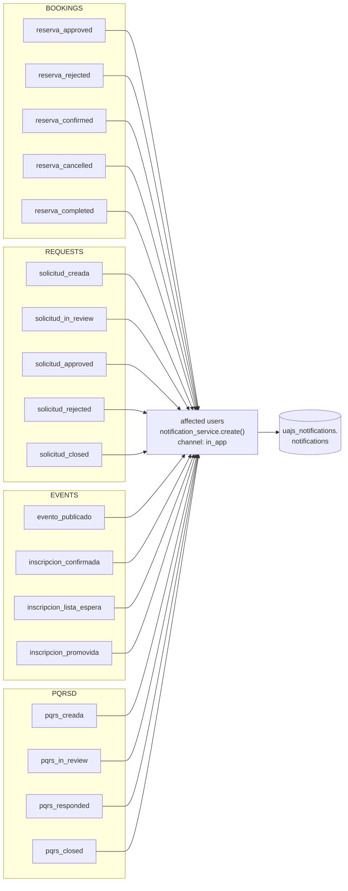

> Alcance real: solo se **crea** notificación in-app persistida; los correos
> reales del sistema (reset de contraseña) van por `auth_emails`
> (auth-service), no por notification-service. Los productores síncronos
> `notify()` acotan su espera con `Promise.race` (2 s) para no colgar la
> petición HTTP con Redis caído.
>
> Detalle de código: `auth.producer.js` publica en `auth_events` (hardcodeado),
> no en el default `auth_emails` de `EMAIL_QUEUE`; `auth_events` no tiene
> consumidor (la cola de auditoría de auth queda sin consumir actualmente).

---

## 3.5. Llamadas HTTP entre servicios (service-to-service)

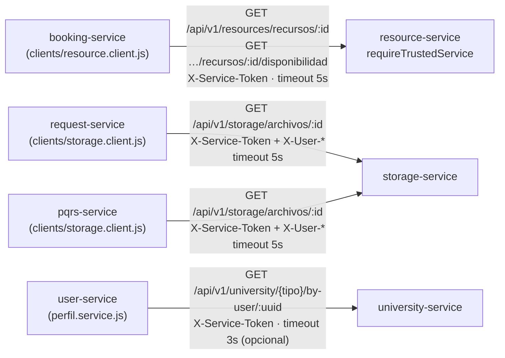

| Origen → Destino | Semántica si el destino falla |
| --- | --- |
| booking → resource | estado falso `no disponible` en la reserva (degradación segura) |
| request/pqrs → storage | metadata de archivo `null` (no se confía en MIME/tamaño del cliente) |
| user → university | perfil "basico" con el rol del JWT |

---

## 3.6. Índices de Elasticsearch (13)

Definidos en `packages/shared-elasticsearch/src/client.js` y creados por
`scripts/elasticsearch/setup.js`:

| Índice | Propiedad | Mapping |
| --- | --- | --- |
| `uajs_auth` | dominio + auditoría auth | `auth.mapping.js` |
| `uajs_users` | dominio usuarios | `user.mapping.js` |
| `uajs_logs-*` | logs centralizados (patrón) | (runtime) |
| `uajs_events` | dominio eventos | `event.mapping.js` |
| `uajs_resources` | dominio recursos | `resource.mapping.js` |
| `uajs_bookings` | dominio reservas | `booking.mapping.js` |
| `uajs_catalogs` | dominio catálogos | `catalog.mapping.js` |
| `uajs_university` | dominio académico | `university.mapping.js` |
| `uajs_requests` | dominio solicitudes | `request.mapping.js` |
| `uajs_notifications` | dominio notificaciones | `notification.mapping.js` |
| `uajs_pqrs` | dominio PQRS | `pqrs.mapping.js` |
| `uajs_storage` | dominio archivos | `storage.mapping.js` |
| `uajs_gateway` | rastreo de gateway | `gateway.mapping.js` |

Además, la auditoría secuencial de cada servicio escribe en `uajs_<dominio>_events`
(por ejemplo `uajs_bookings_events`), creada como variante `_events` del índice de dominio.
La búsqueda de logs usa la plantilla `uajs_paginated_search`, `uajs_date_range_search`
o `uajs_full_text_search` según el caso.

Toda llamada a ES desde un path síncrono usa el `circuitBreakerTimeout` de 2000 ms
desacoplado de la latencia real de la consulta (30 s), de modo que nunca quedará
un request HTTP colgando si Elasticsearch no está disponible.

---

## 3.7. Secuencia de referencia: rservación end-to-end

Leído directamente de `ReservaService#create` y `approval`:

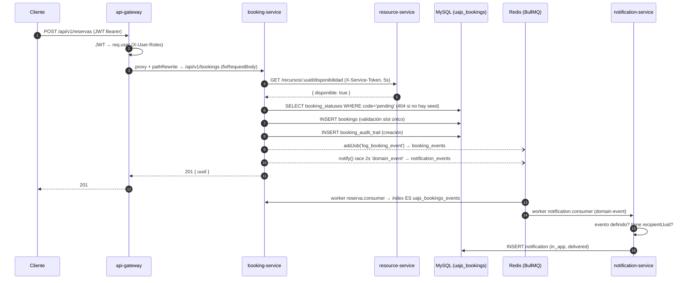

---

## Resumen de discrepancias detectadas (útil para la siguiente fase)

1. `catalog-service/src/config/env.js` tiene `PORT` default **3002** (colisión
   con user-service); su `.env.example` ya usa `PORT=3003` — corregir default.
2. `auth.producer.js` publica en `auth_events` (hardcodeado) en lugar de
   `EMAIL_QUEUE` (`auth_emails`); `auth_events` no tiene consumidor.
3. No hay seeds para `uajs_notifications`/`uajs_storage` (aceptable, no hace
   falta para `create()`).
4. `AGENTS.md` aún dice "Most services under apps/ are empty scaffolds" — ya no
   es cierto; los 12 están implementados.
